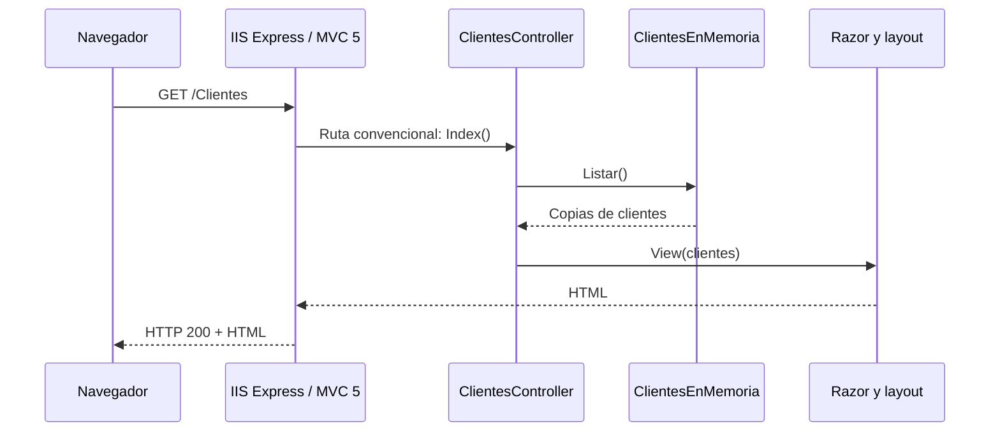

# Recorrido del código durante la capacitación

Los archivos y enlaces de este recorrido corresponden a la rama `modulo-1-gap-tecnologico`. En la rama del Módulo 2, Cliente se trasladó a `FacturacionLegacy.Datos/Entidades/Cliente.cs` y el almacenamiento en memoria se retiró; usar [la guía del Módulo 2](../modulo-2/README.md) para esa versión. Abrir el proyecto del Módulo 1, poner un breakpoint en `ClientesController.Index` y ejecutar con IIS Express.

## Una petición GET a /Clientes

1. **El usuario ingresa a `/Clientes`.** IIS Express recibe la petición. El [proyecto](../../legacyGestionDeFacturacion.web/legacyGestionDeFacturacion.web.csproj) conserva `UseIISExpress=true` y .NET Framework v4.8. [Web.config](../../legacyGestionDeFacturacion.web/Web.config) define el runtime ASP.NET y los handlers del sitio.
2. **MVC resuelve la ruta.** Al arrancar la aplicación, [Global.asax](../../legacyGestionDeFacturacion.web/Global.asax) enlaza con [Global.asax.cs](../../legacyGestionDeFacturacion.web/Global.asax.cs). `Application_Start` registra rutas, filtros y bundles una vez por inicio del AppDomain. [RouteConfig.cs](../../legacyGestionDeFacturacion.web/App_Start/RouteConfig.cs) define `{controller}/{action}/{id}`: `/Clientes` selecciona `controller=Clientes`, `action=Index` por defecto e ID opcional. `/` selecciona `Home/Index`.
3. **Se ejecuta una acción del controller.** MVC crea [ClientesController](../../legacyGestionDeFacturacion.web/Controllers/ClientesController.cs), que hereda de `System.Web.Mvc.Controller`, y llama a `Index()`. El atributo `[HttpGet]` delimita el verbo admitido.
4. **El controller obtiene los clientes.** `ClientesEnMemoria.Listar()` accede a la colección de [ClientesEnMemoria.cs](../../legacyGestionDeFacturacion.web/Models/ClientesEnMemoria.cs). La colección es estática, compartida entre peticiones; `lock` protege el acceso. El método devuelve una lista de copias de [Cliente](../../legacyGestionDeFacturacion.web/Models/Cliente.cs), evitando mutaciones externas. Hay tres clientes iniciales.
5. **MVC devuelve una vista Razor.** `return View(clientes)` produce un `ViewResult`, que es un `ActionResult`. MVC busca [Views/Clientes/Index.cshtml](../../legacyGestionDeFacturacion.web/Views/Clientes/Index.cshtml), cuyo `@model` es una secuencia de clientes. El `foreach` genera filas y `Html.ActionLink` construye los enlaces siguiendo las rutas.
6. **El navegador recibe HTML generado.** [_ViewStart.cshtml](../../legacyGestionDeFacturacion.web/Views/_ViewStart.cshtml) selecciona [_Layout.cshtml](../../legacyGestionDeFacturacion.web/Views/Shared/_Layout.cshtml). `RenderBody` incorpora la tabla y los bundles registrados en [BundleConfig.cs](../../legacyGestionDeFacturacion.web/App_Start/BundleConfig.cs) incluyen CSS y JavaScript. El navegador interpreta HTML; no ejecuta el código C# de Razor.

## Del formulario al almacenamiento

`GET /Clientes/Create` muestra [Create.cshtml](../../legacyGestionDeFacturacion.web/Views/Clientes/Create.cshtml). Su parcial [_Formulario.cshtml](../../legacyGestionDeFacturacion.web/Views/Clientes/_Formulario.cshtml) genera campos con nombres que coinciden con `Cliente`. Los helpers emiten atributos de validación y la sección `scripts` incorpora jQuery Validation y unobtrusive.

Al guardar, el formulario envía POST con el token de `Html.AntiForgeryToken()`. `[ValidateAntiForgeryToken]` comprueba el token y la cookie. El model binder construye un `Cliente` solo con los campos permitidos por `[Bind]`; MVC aplica Data Annotations y registra errores en `ModelState`. Si hay errores se devuelve la misma vista con datos y mensajes, sin guardar. Si los datos son válidos, `Crear` asigna un ID y estado activo dentro del `lock` y el controller redirige al detalle. La nueva petición GET permite observar que los datos sobreviven al controller que atendió el POST.

`GET /Clientes/Details/{id}` usa `Obtener` y [Details.cshtml](../../legacyGestionDeFacturacion.web/Views/Clientes/Details.cshtml). La edición usa [Edit.cshtml](../../legacyGestionDeFacturacion.web/Views/Clientes/Edit.cshtml) y una acción POST independiente: actualiza campos personales, conserva ID y estado y redirige al detalle. IDs inexistentes o ausentes devuelven `HttpNotFound()`.

## Desactivación con POST y PATCH

[_Desactivar.cshtml](../../legacyGestionDeFacturacion.web/Views/Clientes/_Desactivar.cshtml), reutilizado en listado y detalle, crea un formulario POST con antiforgery y `Html.HttpMethodOverride(HttpVerbs.Patch)`. En el HTML aparece `X-HTTP-Method-Override=PATCH`; es útil comparar el método de transporte POST en la pestaña Network con el verbo efectivo interpretado por MVC.

`ClientesController.Desactivar` acepta POST o PATCH mediante `AcceptVerbs`, comprueba antiforgery, cambia únicamente `Activo` y redirige al listado. También admite PATCH real con token y cookie; `Web.config` incluye PATCH en `ExtensionlessUrlHandler-Integrated-4.0` para que IIS lo envíe al pipeline ASP.NET. GET no puede ejecutar la operación. No se borra el registro, por lo que sigue apareciendo como inactivo.

## Ejercicios de las clases 1 y 2

Crear y editar un cliente, navegar al listado y abrirlo en otra pestaña. Desactivar desde el detalle y observar el estado. Deshabilitar JavaScript para comprobar que el servidor continúa validando. Inspeccionar el HTML para distinguir Razor de su resultado y ubicar el token antiforgery. Detener y reiniciar IIS Express para ver los datos iniciales nuevamente. Finalmente recorrer `.csproj`, `packages.config`, `Web.config` y `App_Start` y relacionarlos con [los puntos de migración](puntos-de-migracion.md).
