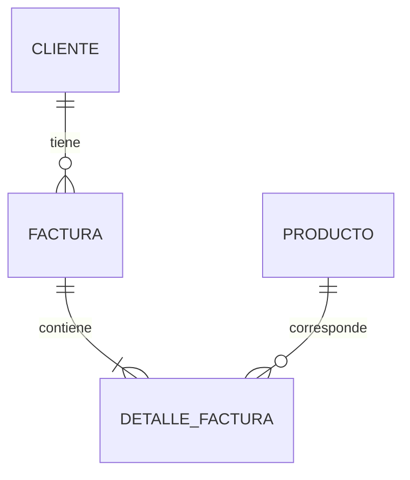

# Entity Framework 6 y SQL Server

EF6 es un ORM: relaciona objetos C# y tablas y traduce consultas LINQ a SQL. `System.Data.Entity.DbContext` representa una unidad de trabajo; consulta, sigue cambios y los persiste con `SaveChanges`. Debe liberarse al terminar y no compartirse entre hilos. Ver [trabajo con DbContext](https://learn.microsoft.com/en-us/ef/ef6/fundamentals/working-with-dbcontext).

## Archivos y modelo real

[`FacturacionDbContext.cs`](../../FacturacionLegacy.Datos/FacturacionDbContext.cs) define cinco DbSet: Clientes, Productos, Facturas, DetallesFactura y Usuarios. Las entidades están en [`Entidades/`](../../FacturacionLegacy.Datos/Entidades/Factura.cs). Cliente conserva las propiedades del módulo anterior; sus vistas ahora referencian la clase de la biblioteca compartida.

Un cliente tiene muchas facturas; una factura tiene muchos detalles; cada detalle referencia un producto. Las FK son obligatorias y se deshabilita el borrado en cascada para preservar el historial. Las claves `Id` son identity de SQL Server. PrecioUnitario, Subtotal, Impuestos y Total se configuran como decimal(18,2), nunca float/double. Código de producto, número de factura y nombre de usuario tienen índices únicos. Las migraciones agregan restricciones SQL de estados, roles e importes no negativos.



El precio histórico está en DetalleFactura, aunque el producto cambie. Los datos del cliente y nombre/código del producto siguen consultándose desde sus registros actuales; no se implementó una copia completa de esos textos. Desactivar conserva los registros.

## Conexión y migraciones

La conexión `FacturacionDb` se busca por nombre en la configuración del proceso anfitrión. Para MVC/WCF es `Web.config`; para ejecutables es el `.exe.config` generado desde `App.config`. Todos deben apuntar a la misma base. LocalDB es por usuario; un servicio con otra identidad no accede automáticamente a la instancia del desarrollador.

Code First Migrations registra cambios de esquema mediante clases con `Up`/`Down` y metadatos de modelo. Se deshabilitaron migraciones automáticas y creación automática en el arranque de la web. [`Migraciones/Configuration.cs`](../../FacturacionLegacy.Datos/Migraciones/Configuration.cs) mantiene un Seed que inserta ejemplos ausentes. Las migraciones `Inicial` y `Usuarios` incluyen `.Designer.cs` y `.resx` generados por EF6; los recursos están asociados a sus clases en el proyecto. Conceptos y comandos de PMC en [Code First Migrations](https://learn.microsoft.com/en-us/ef/ef6/modeling/code-first/migrations/).

Desde Visual Studio Package Manager Console:

```powershell
Update-Database -ProjectName FacturacionLegacy.Datos -StartUpProjectName legacyGestionDeFacturacion.web -ConfigurationTypeName FacturacionLegacy.Datos.Migraciones.Configuration
```

La alternativa reproducible sin PMC es ejecutar `FacturacionLegacy.Tools.exe migrar` tras compilar. Para generar un cambio futuro: modificar entidades/mapeos, compilar Tools, ejecutar `crear-migracion Nombre .\FacturacionLegacy.Datos\Migraciones`, inspeccionar el código generado, volver a compilar y aplicar `migrar`. No modificar una migración ya aplicada para representar un cambio nuevo. Las partes SQL adicionales, como secuencias y checks, necesitan revisión expresa; no se deducen del snapshot.

## Consultas y operaciones

[`ClientesController`](../../legacyGestionDeFacturacion.web/Controllers/ClientesController.cs) consulta con `AsNoTracking` para el listado y usa entidades seguidas para editar. [`ProductosController`](../../legacyGestionDeFacturacion.web/Controllers/ProductosController.cs) valida códigos y maneja la violación del índice único. Cada controller libera su contexto en `Dispose`.

[`FacturacionOperaciones`](../../FacturacionLegacy.Datos/FacturacionOperaciones.cs) centraliza `Crear`, `Consultar`, `Obtener`, `ContarPendientes`, `Emitir` y `Anular`. `Include` carga relaciones explícitas; lazy loading y proxies están deshabilitados. `Crear` usa una transacción Serializable para validar precios/estados y guardar cabecera y detalles; no acepta totales del formulario. `SELECT NEXT VALUE FOR dbo.NumeroFactura` asigna números concurrentes y el índice único refuerza la garantía. Las transiciones usan UPDATE parametrizado con estado esperado; una transición inválida no modifica filas.

## Comparación conceptual con EF Core

EF Core tiene otra implementación y APIs; no se reemplaza EF6 cambiando solo el paquete. Sus migraciones no comparten directamente el historial de EF6. La [guía de portabilidad](https://learn.microsoft.com/en-us/ef/efcore-and-ef6/porting/) también aclara que EF6 puede usarse en .NET moderno: aquí no se afirma una incompatibilidad absoluta de EF6 con .NET 10.

Los alumnos deberán revisar mapeos, precisión, traducción de LINQ, carga de relaciones, transacciones, secuencia e índices, permisos SQL y estrategia de esquema/historial. Comparar los importes y consultas antes/después. No se agregaron paquetes EF Core ni un contexto moderno en esta rama.
