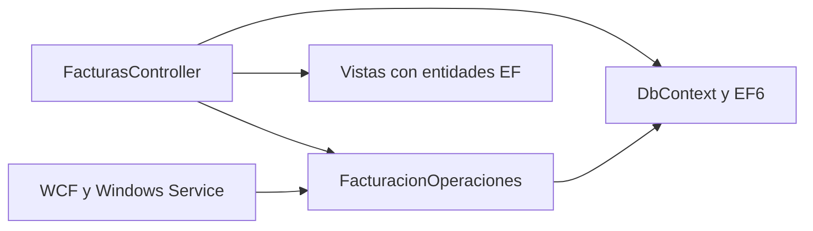
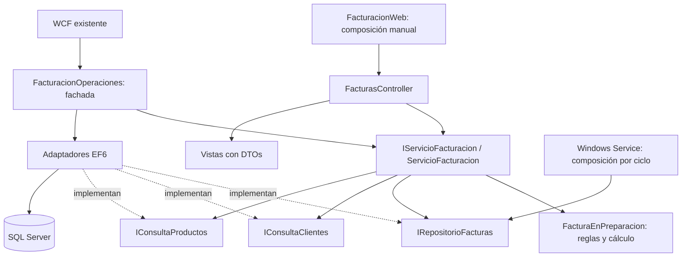

# Arquitectura antes y después

## Antes: un flujo separado de MVC, pero ligado a EF6

En el Módulo 2, `FacturasController` ya delegaba la creación a `FacturacionOperaciones`. No contenía la fórmula de impuestos, pero consultaba EF6 para listados, catálogos, reportes y existencia de facturas. `FacturacionOperaciones.Crear` reunía reglas, cálculos y SQL. Las vistas de facturas recorrían entidades persistidas y navegaciones.

## Después: responsabilidades explícitas para facturación

| Responsabilidad | Archivo/método real | Lo que controla |
| --- | --- | --- |
| HTTP y presentación | `Controllers/FacturasController.cs`, acciones existentes | ModelState, mensajes, vistas, redirects, 400/404/409, roles y antiforgery. |
| Preparación de dependencias | `Composicion/FacturacionWeb.cs` | Un DbContext por petición, adaptadores concretos, lectura diferida de TasaImpuestos y liberación del contexto. |
| Caso de uso | `Facturacion/Aplicacion/ServicioFacturacion.cs`, `Crear` | Valida la solicitud, abre la transacción, comprueba cliente/productos activos, llama al dominio, guarda y confirma. |
| Reglas de creación | `Facturacion/Dominio/FacturaEnPreparacion.cs`, `ValidarSolicitud` y `Crear` | Cantidades, límite de detalles, precios, redondeo, subtotales, impuestos, total e instantánea de detalles. |
| Persistencia | `Facturacion/Infraestructura/RepositorioFacturasEf6.cs` | Serializable, secuencia, mapeo a entidades, SaveChanges, consultas y UPDATE con estado esperado. |
| Catálogo de clientes | `Clientes/ConsultaClientesEf6.cs` | Consulta ordenada y opción de filtrar clientes activos; comprobación de actividad. |
| Catálogo de productos | `Productos/ConsultaProductosEf6.cs` | Productos activos para el formulario y precios/estado vigentes para el caso de uso. |
| Compatibilidad | `FacturacionOperaciones.cs` | Conserva las firmas existentes para WCF, WindowsService y otros consumidores del Módulo 2. |

Las interfaces y DTOs de facturación están en `Facturacion/Contratos.cs`. El controller ya no crea ni consulta un DbContext. El servicio recibe contratos mediante su constructor. Los adaptadores concretos son seleccionados por la composición manual, fuera de las acciones; no se instala ningún contenedor.

El dominio usa colecciones, decimal y el contrato simple `LineaFactura`, que ya existía fuera de las entidades EF. No referencia System.Web ni APIs de Entity Framework. Aplicación utiliza contratos de módulos, dominio y los valores de estado existentes; infraestructura conoce EF6. Toda esta separación es lógica dentro de `FacturacionLegacy.Datos`: el ensamblado sigue conteniendo EF6 y no hay barreras de compilación entre carpetas.

## Áreas funcionales y monolito modular

Clientes y Productos tienen namespaces propios para contratos de consulta usados por Facturación. Facturación agrupa sus contratos y sus carpetas Aplicacion/Dominio/Infraestructura. Usuarios sigue representado por Usuario/RolesUsuario, AccountController, PasswordSeguridad y Forms Authentication. No se movieron sus archivos ni se inventó un servicio de usuarios que el flujo no necesita.

La web sigue siendo un monolito. WCF y Windows Service siguen siendo anfitriones separados que comparten una biblioteca y la base. No se crearon microservicios ni se afirma que los módulos sean desplegables por separado.

Para profundizar la modularización, una evolución posterior podría asignar contratos y propiedad de escrituras a cada área, retirar referencias directas a DbSet desde sus CRUD y prohibir cruces de infraestructura entre módulos. Esa decisión requiere necesidades concretas y coordinación con el Módulo 4; no se realizan movimientos masivos ahora. Una separación lógica puede aportar valor sin multiplicar proyectos, como explica la [guía de arquitecturas web de Microsoft](https://learn.microsoft.com/en-us/dotnet/architecture/modern-web-apps-azure/common-web-application-architectures).

## Aspectos deliberadamente pendientes

ClientesController, ProductosController, AccountController y Global.asax conservan acceso directo a EF6. Los DTOs SOAP y la configuración de sus anfitriones se conservan. La fachada todavía ofrece IQueryable y entidades para compatibilidad, por lo que esos consumidores siguen relacionados con EF6; la nueva interfaz de facturación no expone esos tipos. Son límites visibles del refactor, no una arquitectura limpia completa.

## Integración acumulativa en Módulo 4

Después del merge `71d866e`, `IConsultaProductos` incorpora ListarAsync/ObtenerAsync usando el mismo ProductoConsultaDto y adaptador EF6; los métodos síncronos y la creación permanecen iguales. `IRepositorioFacturas` incorpora ContarPendientes; la fachada conserva su firma delegando en el repositorio. El Windows Service compone esa operación por ciclo y mantiene timer/logging. Detalles y validación pendiente: [integración Módulo 4](../../../docs/modulo-4/integracion-modulo-3.md). No se introducen contenedores ni se cambian las reglas de dominio.
