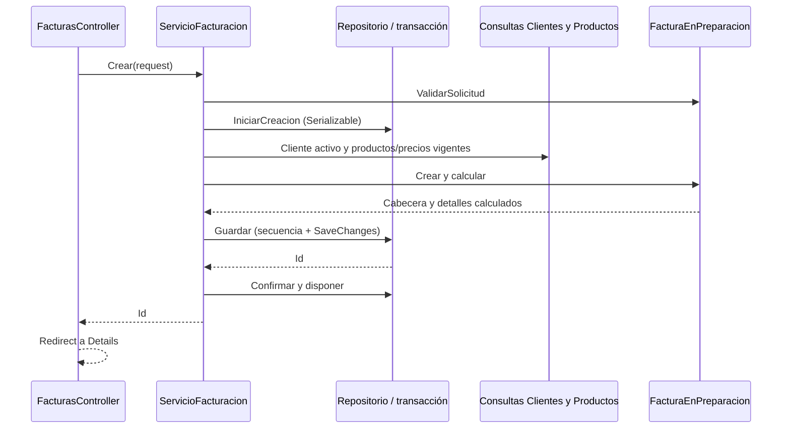

# Recorrido de creación de una factura

Las rutas y nombres del formulario se mantienen. El ejemplo usa POST `/Facturas/Create`, cliente activo, dos detalles y tasa didáctica 0.21. El importe enviado desde el navegador nunca reemplaza el cálculo del servidor.

1. **MVC valida HTTP y el modelo.** `legacyGestionDeFacturacion.web/Controllers/FacturasController.cs` conserva permisos ADMIN/OPERADOR, `[HttpPost]`, `[ValidateAntiForgeryToken]` y `[Bind(Include = "ClienteId,Detalles")]`. `Models/FacturaCrearModel.cs` y `LineaFactura` conservan sus Data Annotations. Si ModelState es inválido, se reconstruyen los selectores y se devuelve la misma vista, sin llamar al guardado.
2. **El controller forma la solicitud.** `Create` construye `CrearFacturaRequest` con ClienteId y Detalles y llama a `IServicioFacturacion.Crear`. No consulta DbSet, no conoce SQL y no calcula precios ni totales.
3. **Aplicación valida y abre la unidad transaccional.** `FacturacionLegacy.Datos/Facturacion/Aplicacion/ServicioFacturacion.cs` valida la estructura mediante `FacturaEnPreparacion.ValidarSolicitud`. `IRepositorioFacturas.IniciarCreacion` abre una transacción Serializable. Se lee la tasa una sola vez para toda la operación; el proveedor web la obtiene de la misma clave Web.config utilizada antes.
4. **Se validan datos vigentes dentro de la transacción.** `IConsultaClientes.EstaActivo` verifica el cliente; `IConsultaProductos.Obtener` trae productos por IDs distintos. El servicio rechaza faltantes o inactivos y construye el diccionario de precios. Los adaptadores EF6 comparten el mismo DbContext en `Composicion/FacturacionWeb.cs`; estas lecturas quedan dentro de la transacción que protegerá la escritura.
5. **El dominio construye una factura válida.** `Facturacion/Dominio/FacturaEnPreparacion.Crear` toma precios de ese diccionario, copia cada línea y calcula sus importes con decimal. Usa `Round(..., 2, MidpointRounding.AwayFromZero)`, suma subtotales, calcula impuestos y total y comprueba el límite de almacenamiento. Devuelve un objeto con setters privados y detalles de solo lectura. No acepta subtotales, impuestos ni total en el contrato de entrada. Las líneas repetidas, cantidades válidas, precio cero y stock informativo siguen permitidos como antes.
6. **Infraestructura persiste el conjunto.** `Facturacion/Infraestructura/RepositorioFacturasEf6.Guardar` obtiene `NEXT VALUE FOR dbo.NumeroFactura`, conserva el formato `FAC-` y diez dígitos, crea las entidades Factura/DetalleFactura existentes, fija PENDIENTE y copia los precios históricos calculados. `SaveChanges` guarda cabecera y detalles. No modifica stock ni el esquema.
7. **Aplicación confirma o libera.** Después de un guardado exitoso llama a `Confirmar`. Un error previo a la confirmación sale por `using`: la implementación EF6 dispone la transacción sin commit. El contexto lo dispone el anfitrión al finalizar la petición. La transacción no se extiende hasta la generación de HTML.
8. **MVC presenta el resultado.** El ID vuelve al controller, que usa el mismo mensaje TempData y redirige a Details. Las violaciones esperadas de reglas siguen siendo ArgumentException convertidas en errores de ModelState; los errores de infraestructura no se disfrazan como validación del usuario. `Details` devuelve `FacturaDetalleDto`, y Razor genera el mismo contenido con campos explícitos en vez de navegaciones EF.

Con precios 125.50×2 y 100×3: detalles 251.00 y 300.00; subtotal 551.00; impuestos 115.71; total 666.71. Si un precio cambia después, la factura conserva los importes históricos de sus detalles. Nombre/código de producto y datos de cliente siguen consultándose del registro actual, igual que en el Módulo 2.

`Emitir` y `Anular` conservan autorización ADMIN y antiforgery. El servicio informa Actualizado/NoExiste/Conflicto y el controller traduce a redirect/404/409. El repositorio mantiene UPDATE parametrizado con estado esperado, de modo que dos solicitudes no pueden ignorar las transiciones válidas. No se incorpora edición de facturas.
